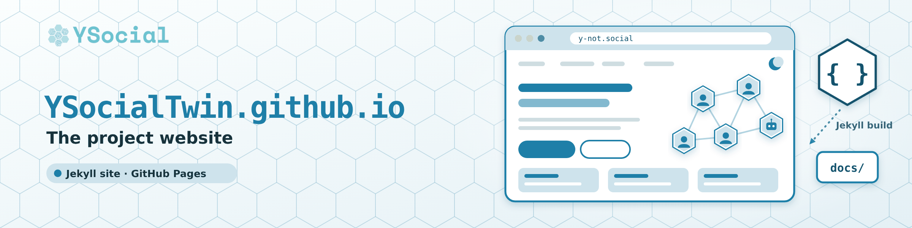

# YSocialTwin.github.io

<p align="center">
  
</p>

> Source of the [YSocial](https://y-not.social/) project website: documentation, downloads, plugins, blog.

<p align="center">
  <a href="https://y-not.social/"><b>Website</b></a> &nbsp;·&nbsp;
  <a href="https://github.com/YSocialTwin/YSocial">YSocial</a> &nbsp;·&nbsp;
  <a href="https://github.com/YSocialTwin/YSocial/releases/latest">Download</a> &nbsp;·&nbsp;
  <a href="#run-the-site-locally">Run locally</a> &nbsp;·&nbsp;
  <a href="#publishing">Publishing</a>
</p>

<p align="center">
  <a href="https://github.com/YSocialTwin/YSocial/releases/latest"></a>
  
  
</p>

**Contents:** [Overview](#overview) · [Repository layout](#repository-layout) · [Run the site locally](#run-the-site-locally) · [Common problems](#common-problems) · [Publishing](#publishing) · [Contributing](#contributing)

## Overview

This repository hosts the website of **YSocial**, the digital twin of an online social media platform whose agents are powered by Large Language Models. Looking for the software itself? Go to the [YSocial repository](https://github.com/YSocialTwin/YSocial).

The site is a [Jekyll](https://jekyllrb.com/) project. GitHub Pages serves the pre-built `docs/` folder, so the live site only changes when `docs/` is rebuilt and merged (see [Publishing](#publishing)).

The `v4.0.0` branch holds the new site: the style of the YSocial login, a dark theme with a light/dark toggle (the choice is remembered in the browser), and the content for the 4.0.0 release. It is not built or published until you decide to, so the live site stays the current one.

## Repository layout

| Path | What it holds |
| --- | --- |
| `_pages/` | The pages (Markdown), e.g. home, download, what's new, plugins, key features |
| `_posts/` | Blog posts |
| `_data/` | Data used by the templates, e.g. `plugins.yml` (the Plugins page), `members.yml`, `citations.yml` |
| `_layouts/`, `_includes/` | Page layouts and reusable fragments |
| `assets/` | CSS, JavaScript, images, fonts |
| `_config.yml` | Site configuration: menu, `ysocial_version`, `release_url`, excludes |
| `_build_config.yml` | Extra settings used only to build into `docs/` |
| `scripts/` | Helper scripts, e.g. `make_og_images.py` (social preview cards) |
| `docs/` | The built site served by GitHub Pages. Never edit it by hand |

## Run the site locally

Requirements: Ruby 3.x with Bundler (`ruby -v`, `bundle -v`) and an internet connection on the first run (Font Awesome and Bootstrap are loaded from a CDN).

```bash
git clone https://github.com/YSocialTwin/YSocialTwin.github.io.git
cd YSocialTwin.github.io
git checkout v4.0.0
bundle install
bundle exec jekyll serve --livereload
```

Open <http://127.0.0.1:4000>. Changes to pages, CSS and JS reload by themselves; `_config.yml` is read again only when you restart the command.

Do **not** add `--config _config.yml,_build_config.yml` to the command above: that configuration writes into `docs/` and is reserved for publishing. With the preview command the output goes to `_site/`, which git ignores.

To try the site on a phone, run `bundle exec jekyll serve --host 0.0.0.0` and open `http://<computer-ip>:4000`.

### What to check

* **Home:** hero with the animated network and the simulated feed; the button at the top right switches between dark and light theme.
* **Menu:** Get started, Inside YSocial (with the *Plugins* page), ySights, Resources, Blog, About.
* **New pages:** `/whats_new` and `/plugins`.
* **Download:** detects the operating system and highlights the matching installer; the version shown comes from `ysocial_version` in `_config.yml`.

## Common problems

* **`bundle install` fails on `wdm` (Windows):** comment out the line in the `Gemfile` and run `bundle install` again, without committing the change:

  ```ruby
  # gem "wdm", "~> 0.1.1", :platforms => [:mingw, :x64_mingw, :mswin]
  ```

* **Port 4000 is busy:** `bundle exec jekyll serve --port 4001`.
* **Old styles after an update:** reload without cache (Ctrl/Cmd+Shift+R).
* **Missing menu icons:** Font Awesome comes from a CDN, check your connection.

## Social preview images

Links shared on social platforms show a 1200×630 card (`og:image`). The theme takes it from the `header_img` of each page, and the page header itself never displays it.

* **Default:** `assets/images/og-default.png` for every page, `assets/images/og-blog.png` for posts without their own image (both set in `_config.yml`, under `defaults`).
* **Posts and key pages:** one card each in `assets/images/og/`, e.g. `blog-<post-name>.png`, `download.png`.
* **Regenerate:** `python3 scripts/make_og_images.py` from the repository root (needs [Pillow](https://pypi.org/project/pillow/), `pip install pillow`). It reads titles and subtitles from the front matter.
* **New post or page:** run the script, then add `header_img: assets/images/og/blog-<post-name>.png` to its front matter. To add a page to the script, append it to the `for page, label in [...]` list at the bottom.
* **After publishing:** platforms cache previews. Refresh them with the Facebook Sharing Debugger or LinkedIn Post Inspector.

## Publishing

```bash
bundle exec jekyll build --config _config.yml,_build_config.yml   # rewrites docs/
```

Then commit `docs/` and merge into `main`. Until then there is nothing to do: `docs/` is untouched on the `v4.0.0` branch.

## Contributing

Fix a typo, add a plugin to `_data/plugins.yml`, or write a blog post in `_posts/`: open a pull request against the `v4.0.0` branch and check the result locally first. For the software itself, see the [YSocial repository](https://github.com/YSocialTwin/YSocial).
